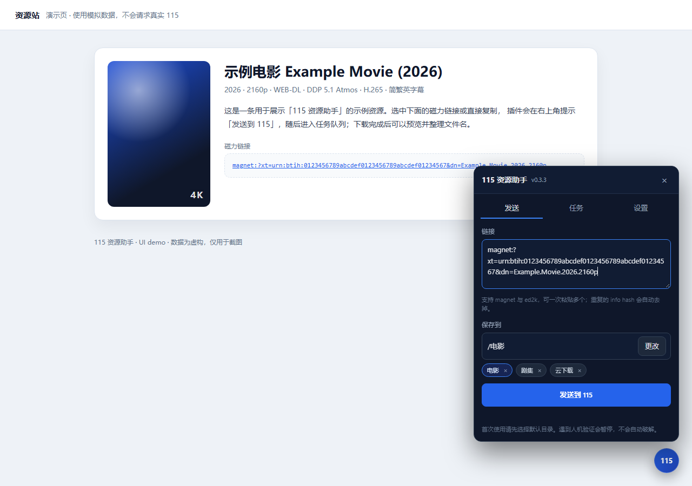
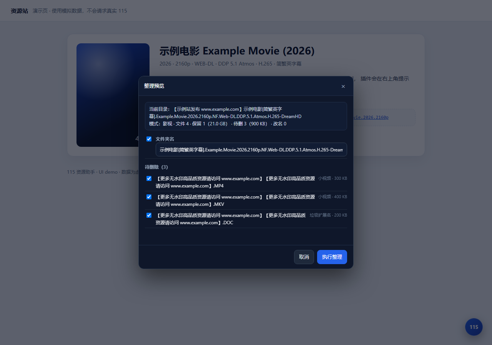

# 115 资源助手

> 选中或复制磁力链接，一键推送到 115 云下载；低频轮询任务，下载完成后整理文件夹名、文件名和垃圾文件。


[](https://ghproxy.net/https://raw.githubusercontent.com/Marcus-Jiang/115-resource-helper/main/115-resource-helper.user.js)




## 功能

- **一键推送**：选中/复制磁力、ed2k 链接，点提示即可发送到 115 云下载；发送后自动跳到任务页。
- **低风控调度**：所有 115 请求串行、限速、带每小时预算；遇到 `911` 暂停并引导手动验证，不自动破解。
- **任务队列**：推送前记录目标目录快照，低频轮询 115 任务列表；完成后通过目录差异定位结果文件夹。
- **整理引擎**：去广告括号/域名/关键词，保留字幕和有意义标签；保留最大视频，删样片/广告/垃圾；删除进 115 回收站。
- **多种资源模式**：影视、剧集、音乐、软件/电子书、通用，避免用视频规则误删其他资源。
- **可预览**：默认先弹预览，逐项勾选删除/改名；自动整理需要手动开启。
- **常用目录**：自动记录最常使用/最近使用的 3 个目录，一键切换。
- **任务筛选**：默认只看未完成任务，已完成/已忽略单独放一起。

## 安装

### 方式一：从 CDN 安装（推荐）

1. 安装 [Tampermonkey（篡改猴）](https://www.tampermonkey.net/)。
2. 打开：

   ```
   https://ghproxy.net/https://raw.githubusercontent.com/Marcus-Jiang/115-resource-helper/main/115-resource-helper.user.js
   ```

   如果 ghproxy 不可用，改用 jsDelivr：

   ```
   https://cdn.jsdelivr.net/gh/Marcus-Jiang/115-resource-helper@latest/115-resource-helper.user.js
   ```

3. Tampermonkey 会弹出安装页，点「安装」。
4. 打开任意网页，右下角出现圆形 **115** 悬浮球。

> 发布前请先运行 `node scripts/set-repo.mjs <你的GitHub用户名>` 替换占位符。

### 方式二：本地文件

1. 打开 Tampermonkey 管理面板 → 「添加新脚本」。
2. 用 `115-resource-helper.user.js` 的全部内容覆盖默认模板，保存。
3. 或者在 Tampermonkey「实用工具」里从文件导入。

首次使用会弹一次「使用前须知」，确认后不再出现。

### 更新

- 点击面板标题旁的版本号，或 **设置 → 检查更新**。
- 插件会依次查询 GitHub API、ghproxy、jsDelivr，比较版本；有新版本时给出「去更新」入口。
- 篡改猴自身也会按 `@updateURL`（ghproxy）自动检查；如果失败，用面板内的检查更新。

## 使用

### 1. 推送

1. 点悬浮球 → **设置** → **默认目录** → 选择 115 里的目录（例如 `/电影`）。
   - 「保存到」下面会自动显示**最常使用/最近使用的 3 个目录**（按使用次数排序，次数相同按最近使用排序）。
   - 点目录按钮直接切换；点右侧 `×` 可从常用中移除（再次使用会重新出现）。
2. 在任意网页：
   - **选中**包含磁力/电驴链接的文字 → 右上角出现「发送到 115」提示；
   - 或 **Ctrl+C 复制**磁力链接 → 同样出现提示；
   - 或直接点悬浮球，在输入框里粘贴。
3. 点「发送到 115」。任务进入 115 云下载目录，同时进入插件的任务队列；发送成功后自动切到「任务」页。

支持的链接：

- `magnet:?xt=urn:btih:<40 位 hex 或 32 位 base32>`
- `ed2k://|file|...|`

磁力默认精简为 `xt` + `dn`，去掉 tracker；可在设置里关闭。

### 2. 等待下载

- 推送后 **18 秒内** 在 **1.5s / 3s / 5s / 8s / 12s / 18s** 快速检查；这段时间内没完成，就退到 **10 分钟**（可设置）的慢速轮询；超过 2 小时改为 15 分钟。
- 只在页面可见、且当前标签是“主标签”时检查；多个标签之间会同步任务状态。
- 也可以点「立即检查」；状态异常时可点任务卡上的「按目录检查」强制判断完成。
- 如果任务卡在「检查中」，点任务卡上的「重新检查」；0.3.6 起超过 90 秒会自动回收为「等待下载」并重试。
- 任务页顶部有 **未完成 / 已完成 / 全部** 筛选，默认只显示未完成；「已完成」里是已整理/已忽略的任务，可一键清空记录。
- 完成后插件会：
  - 列出目标目录，和推送前快照做差异，定位本次新增的文件夹/文件；
  - 等目录稳定；
  - 扫描结果目录，生成整理计划；
  - 在任务卡显示「待整理」，悬浮球显示绿色数字角标。

### 3. 整理

- 任务卡片 → **预览整理**：
  - 可修改文件夹名（勾选/取消）；
  - 可逐项勾选要删除的垃圾文件/目录；
  - 可逐项勾选要改名的文件/子文件夹；
  - 显示保留/删除数量与大小；
  - 删除量大时需要再点一次确认。
- 任务卡片 → **全自动执行**：跳过预览，直接按计划执行（删除进 115 回收站）。
- 设置里可以打开「下载完成后自动整理」，默认关闭。

### 4. 整理任意目录

任务页 → **整理任意目录**，或在目录选择器里进入某个目录后点 **整理此目录**。适合清理以前已经下载好的文件夹。

## 界面

| 任务页 | 整理预览 |
|---|---|
|  |  |

## 整理规则

### 资源类型（模式）

设置里先选「资源类型」：

| 模式 | 行为 |
|---|---|
| **影视**（默认） | 保留最大视频；其他视频按 `max(最小视频阈值, 最大视频×保留比例)` 判样片；字幕/音频保护；删广告/垃圾 |
| **剧集** | 保留所有 ≥ 最小视频阈值的视频，不按最大视频比例删；适合多集 |
| **音乐** | 保留音频/封面/MV/字幕/说明，不按大小删；只清广告名和小广告页 |
| **软件/电子书** | 保留 exe/zip/pdf/doc 等，只清广告名和小广告快捷方式 |
| **通用** | 只清广告名和空目录，不按扩展名/大小删 |

> 不确定就先用「预览整理」看一遍；预览标题会显示当前模式。

### 剧集模式的额外优化

- **保留所有集**：只按最小视频阈值判断，不按“最大视频 × 比例”删小集。
- **按名字删样片/预告**：`sample / trailer / teaser / preview / 样片 / 预告 / 抢先 / 片花`，即使文件很大也会删；设置里可关闭。
- **花絮/特典保护**：`花絮 / 幕后 / 特典 / 访谈 / featurette / behind the scenes / interview / extras` 默认保留，设置里可关闭。
- **字幕强制保留**、广告名清理、文件夹改名与影视模式一致。
- 暂未做：`S01E01` 集数规范化、季文件夹标准化、同集多版本去重、字幕按集配对。

### 名称清洗

- 删除含域名或广告词的括号：`【...www.xxx.com...】`、`[...]`、`(...)`、`（...）` 等。
- 保留有意义的标签：字幕、中字、简繁、国语、粤语、双语、HDR、DV、REMUX、4K、60帧、导演剪辑、加长、未删减、国配、内封、外挂等。
- 删除裸域名、URL、常见广告短语（更多资源、最新地址、永久地址、扫码、公众号、QQ群、电影天堂…）。
- 清理残留的空括号、连续分隔符、首尾标点。
- 清洗后为空的文件 → 视为广告文件。

例：

```
原：
【示例站发布 www.example.com】示例电影[简繁英字幕].Example.Movie.2026.2160p.NF.WEB-DL.DDP.5.1.Atmos.H.265-DreamHD

清理后：
示例电影[简繁英字幕].Example.Movie.2026.2160p.NF.WEB-DL.DDP.5.1.Atmos.H.265-DreamHD
```

### 垃圾判定（影视/剧集模式）

- 保留最大的视频；其他视频按 `阈值 = max(最小视频阈值, 最大视频 × 保留比例)` 判断，低于阈值视为样片/广告。
- 字幕：**强制保留**（默认开启），不按大小删；`.sup/.pgs` 等大字幕也保留；广告名字幕、字幕压缩包（`Subs.rar`/`字幕.zip`/`.chs.7z`）、字幕命名的 txt 也保留。可在设置里关闭。
- 音频 ≥ 最小音频阈值保留；没有视频的资源走保守模式，全部保留。
- 图片默认删除（可设置保留）。
- 垃圾扩展名（txt/doc/pdf/exe/url/html/nfo/torrent…）默认删除（NFO 可设置保留）。
- 压缩包/ISO ≥ 10MB 保留；小的删除，但名字像字幕包的保留。
- 纯广告名的文件/子目录删除；全空的目录删除。
- **没有足够大的视频时自动切换保守模式**：只删广告名，避免把软件/音乐/电子书误删。

### 安全阀

- **字幕强制保留**（默认），扩展名包括 `srt/ass/ssa/sub/idx/sup/vtt/smi/ttml/pgs/mks` 等；大字幕、广告名字幕、字幕压缩包、字幕命名的 txt 都不删。
- 最大视频/最大文件永远不进删除列表。
- 非视频资源自动走保守模式，只清广告名。
- 默认**不自动整理**，先弹预览；预览里可以逐项取消删除/改名。
- 删除进 115 回收站，可恢复。
- 待删内容超过总量 50% 或超过 100 项时，预览里需要二次确认；自动整理会跳过这类计划。
- 改名只改真正有变化的项；文件夹改名放在最后。
- 删除/改名失败会逐项回退并记录错误。

## 风控设计

| 措施 | 默认值 | 说明 |
|---|---|---|
| 全局串行队列 | 1.2 秒/请求 ± 抖动 | 所有 115 请求都走调度器 |
| 推送间隔 | 10 秒/条 | 设置里可改 |
| 每小时推送上限 | 20 条 | 超过后本小时不再推送 |
| 每小时请求预算 | 300 次 | 所有 115 请求共享 |
| 任务轮询 | 10 分钟（推送后 1.5/3/5/8/12/18 秒快速检查；未完成即慢速） | 只查 1~3 页任务列表；页面隐藏/非主标签不查 |
| 目录读取 | APS 极速接口 + 10 分钟缓存 | 失败回退 webapi |
| 删除 | 20 个/批，批间 0.8 秒 | 失败逐项回退 |
| 改名 | 逐条 `files/edit`，间隔 0.3 秒 | 批量接口待真机验证后再启用 |
| 911（请验证账号） | 暂停全部请求 + 弹窗 | 去 115 页面手动验证；验证后冷却 10 分钟 |
| 590075（操作太频繁） | 60 秒退避 | 不弹验证 |
| 登录失效 | 暂停 + 提示重新登录 | 99 / 990001 / HTML 登录页 |
| 多标签 | 共享风控状态 + 轮询选主 | 一个标签遇到 911，其他标签一起停 |

**不做的**：不自动 OCR 破解验证码、不伪造设备/UA、不自动重试 911。验证必须由人完成。

## 测试

纯函数测试（Node 18+，无依赖）：

```bash
npm run verify
# 或
node --check 115-resource-helper.user.js
node test/core.test.js
```

当前 35 项，覆盖：

- 磁力/ed2k 识别、去重、精简、尾部标点、base32→hex；
- 目录条目归一化（webapi / APS 字段）；
- 名称清洗（实例、保留字幕标签、纯广告名）；
- 整理计划（示例目录树、字幕保留、最大文件保护、广告子目录整体删除、子文件夹改名、非视频保守模式、资源模式、剧集样片/花絮、大字幕保护）。

UI 冒烟测试（不会请求真实 115）：

```
test/ui.html?view=panel | send | picker | settings | pill | tasks | done | preview
```

用假的 `GM_xmlhttpRequest` 返回固定目录/签名/任务，验证面板、发送入队、目录选择器、设置页、选区提示、任务筛选、整理预览。

## 项目结构

```
115-resource-helper.user.js   脚本本体（单文件，无构建）
README.md                     本文件
CHANGELOG.md                  版本记录
CONTRIBUTING.md               开发与 PR 指南
SECURITY.md                   数据与安全说明
LICENSE                       MIT
docs/115-api.md               已确认的 115 接口笔记
docs/ARCHITECTURE.md          模块与数据流
docs/ROADMAP.md               后续计划
docs/PUBLISHING.md            GitHub 发布清单
docs/demo.html                截图用演示页（模拟数据）
docs/images/                  README 截图
test/core.test.js             纯函数测试（35 项）
test/ui.html                  UI 冒烟测试页
scripts/set-repo.mjs          替换 GitHub 占位符
.github/workflows/ci.yml      CI：语法检查 + 单元测试
```

## 常见问题

**为什么不直接做 Edge 扩展？**

这个工具需要以浏览器已登录的 115 会话去调用 115 网页接口，并且要控制 `Referer` / `Origin` 等请求头。Tampermonkey 的 `GM_xmlhttpRequest` 能直接做到；MV3 扩展需要额外的 `declarativeNetRequest` 头改写和更多权限，开发、调试成本都更高。后续如果要后台常驻或原生右键菜单，可以再把核心模块包成扩展。

**为什么任务一直显示“等待下载”？**

115 的任务列表状态有时会滞后，或者返回未识别的状态码。点任务卡上的 **「按目录检查」**，插件会用目标目录差异强制判断完成。仍不动的话，在 **设置 → 诊断** 查看原始任务字段并反馈。

**会不会误删字幕？**

默认强制保留字幕，包括大字幕、广告名字幕、字幕压缩包、字幕命名的 txt；最大文件也不会进删除列表。第一次使用建议先看预览，确认字幕在“保留”而不是“待删除”。

**会不会封号？**

工具会限速、限制推送频率、遇到 911 立即停止，但不保证 100% 安全。请低频使用，不要批量刷任务；遇到人机验证请手动完成。使用风险自负。

**需要 AList / OpenList 吗？**

不需要。目录读取直接走 115 的 APS 接口，失败回退 webapi。以后如果有需要，可以加可选的 AList/OpenList 后端。

**支持 115 分享链接吗？**

暂不支持，目前只处理磁力和 ed2k。HTTP/FTP 直链和分享链接转存在路线图里。

**数据存在哪里？**

设置、任务、常用目录和风控状态都存在 Tampermonkey 的 GM 存储里；没有账号密码，也没有遥测。

## 已知限制

- 任务轮询只在有页面打开时运行；浏览器完全关闭时不会检查，下次打开会继续。
- 任务状态码映射基于老版 `task_lists`；新版接口的 `stat` 语义记录在 `docs/115-api.md`，可用「诊断」查看真实字段。
- 批量改名接口 `batch_rename` 暂未默认启用；当前逐条 `files/edit`，更稳但请求多一点。
- 结果文件夹定位以“推送前快照 + 完成后差异”为主；如果 115 把任务并进已有同名文件夹、或目录里同时新增多个内容，会标记为「需要手动整理」。
- 选区提示目前是右上角 toast，不是选区旁的原位胶囊。
- 还没有：撤销改名、扁平化单层目录、剧集 `S01E01` 模板重命名、季文件夹标准化、同集多版本去重、AList/OpenList 后端。
- 资源类型在生成整理计划时生效；已经生成「待整理」计划的任务不会自动按新模式重算，可以忽略后用「整理任意目录」重新扫描。
- 只支持磁力和 ed2k；HTTP/FTP 直链、115 分享链接转存还没做。
- 不保存密码/Cookie；依赖浏览器已登录的 115 会话。

## 安全与隐私

- 不保存 115 密码或 Cookie，使用浏览器已有的 115 会话。
- 没有遥测/统计；请求只发往 `@connect` 中列出的 115 域名。
- 删除操作进入 115 回收站，可恢复。
- 遇到 `911` 只会暂停并提示手动验证，不自动破解验证码。
- 反馈问题时请勿粘贴 Cookie、登录令牌、个人目录或完整诊断转储。

## 参与贡献

见 [CONTRIBUTING.md](CONTRIBUTING.md)。欢迎提规则、兼容性和文档改进；请保持低频请求和不自动破解验证码的原则。

## 致谢

接口与字段调研参考了这些开源项目（仅作研究，不随本项目分发）：

- [SheltonZhu/115driver](https://github.com/SheltonZhu/115driver)
- [ChenyangGao/p115client](https://github.com/ChenyangGao/p115client)
- [AlistGo/alist](https://github.com/AlistGo/alist)
- ZiPenOk/scripts 中的 JAV老司机与磁力助手（115 网页接口和风控处理的参考）

## 许可证

[MIT](LICENSE)

## 免责声明

个人使用，请低频使用。本工具调用 115 网页接口，非 115 官方产品；账号风控、接口失效、数据损失等风险由使用者自行承担。删除操作进入 115 回收站，但请先用测试目录验证。
